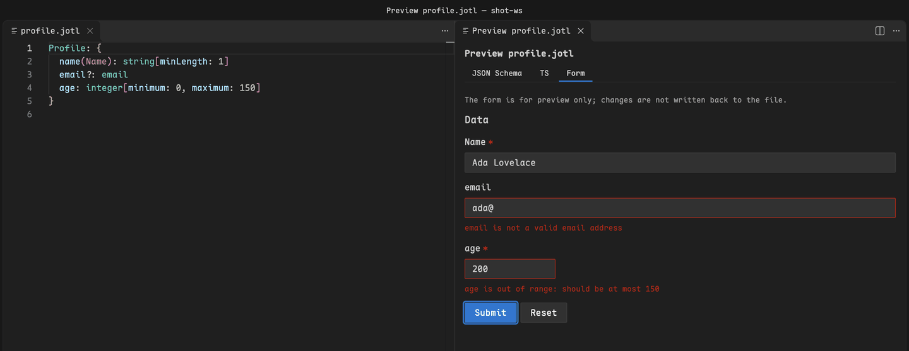

# Jotl

[English](../README.md) · **简体中文**

包页与市场页只显示英文版。

用 Jotl 编写 JSON Schema，边写边检查，编译出的 schema、TypeScript 声明与表单实时可见。

[](https://marketplace.visualstudio.com/items?itemName=heavensky.vscode-jotl)
[](https://marketplace.visualstudio.com/items?itemName=heavensky.vscode-jotl)
[](../LICENSE.txt)

[Jotl](https://github.com/HeavenSky/jotl) 是一门编译为 JSON Schema 2020-12 的简洁语言。这个插件面向维护表单或配置 schema、不想再手改层层嵌套的 JSON 的人。每个字段写一行，写错当场标出；预览面板同时给出编译出的 schema、TypeScript 声明，以及 `@jotl/form` 据此渲染的表单，核对结果不用切到别的工具。

## 看一个文件能产出什么

五行 Jotl 描述一份资料：必填的姓名、选填的邮箱，以及有范围限制的年龄。

```jotl
Profile: {
  name(Name): string[minLength: 1]
  email?: email
  age: integer[minimum: 0, maximum: 150]
}
```

运行 `Jotl: 打开预览`，第一个页签是编译出的 JSON Schema，第二个是下面这段 TypeScript 声明，第三个是表单：必填的 Name 输入框、邮箱输入框，以及限定在 0 到 150 之间的年龄输入框。

```ts
export interface Profile {
	/**
	 * @title Name
	 * @minLength 1
	 */
	name: string;
	/**
	 * @format email
	 */
	email?: string;
	/**
	 * @asType integer
	 * @minimum 0
	 * @maximum 150
	 */
	age: number;
}
```

表单页签边输入边校验，规则与 schema 一致：



## 三步打开实时预览

需要 VS Code 1.101 或更高版本。Jotl 语言服务已打包在插件内，无需另装。

1. 安装插件：

    ```sh
    code --install-extension heavensky.vscode-jotl
    ```

2. 把上面的示例存为 `profile.jotl` 并打开：

    ```sh
    code profile.jotl
    ```

3. 点编辑器标题栏的预览按钮，或在命令面板运行 `Jotl: 打开预览`。预览在编辑器旁打开，随编辑更新。

## 装上之后能做什么

- **写错的地方边写边标出。** 诊断附带快速修复；补全覆盖 widget 名、元数据键、`widget` 取值、条件 `op` 取值，以及 `<root/>`、`<default/>` 标记。
- 交付前先看产物：预览有 JSON Schema、TS 和表单三个页签，前两个各自列出编译与转换诊断。表单只用于预览，修改不会写回文件；面板跟随浅色、深色或高对比度主题。
- 不离开编辑器就能看懂字段：悬停显示字段说明和编译片段；顶层类型支持跳转定义、查找所有引用和大纲。
- 使用项目自己的 widget：在 `jotl.config.json` 中登记，`jotl` 命令行读取同一个文件；还可以把它们的 React 模块加载进预览表单。见[登记项目 widget](docs/project-widgets.md) 和[在预览中加载 widget 模块](docs/widget-modules.md)。
- 在现有 JSON Schema 文件中编辑 `x-ui`：`*.schema.json` 中的 `x-ui` 定义有补全与校验。

## 使用限制

目前有两处限制：

- 文件根写了 `$schema` 时，`*.schema.json` 中的 `x-ui` 校验不生效：VS Code 此时只按该地址取 schema，不再套用按文件名关联的 schema。编辑 `x-ui` 期间可以先删去根 `$schema`，改完再加回（Jotl 生成的 schema 都带它），或者改在 `.jotl` 源文件中编辑。
- 插件只是编辑器。要在脚本和 CI 中编译或检查文件，用 [`jotl` 命令行](../../cli/zh/README.md)；要在浏览器中编辑并预览 Jotl，用 [Playground](../../../apps/playground/zh/README.md)。

插件界面、预览表单和语言服务给出的提示都跟随 VS Code 的显示语言：中文显示语言使用简体中文，其余使用英文。

## 延伸阅读

- [使用指南](docs/README.md)：项目 widget、widget 模块，以及控制它们的设置
- [Jotl 语法规范](../../../zh/docs/spec/jotl.md)和 [`x-ui` 规范](../../../zh/docs/spec/x-ui.md)
- [更新日志](CHANGELOG.md)

## 许可证

[MIT](../LICENSE.txt)
